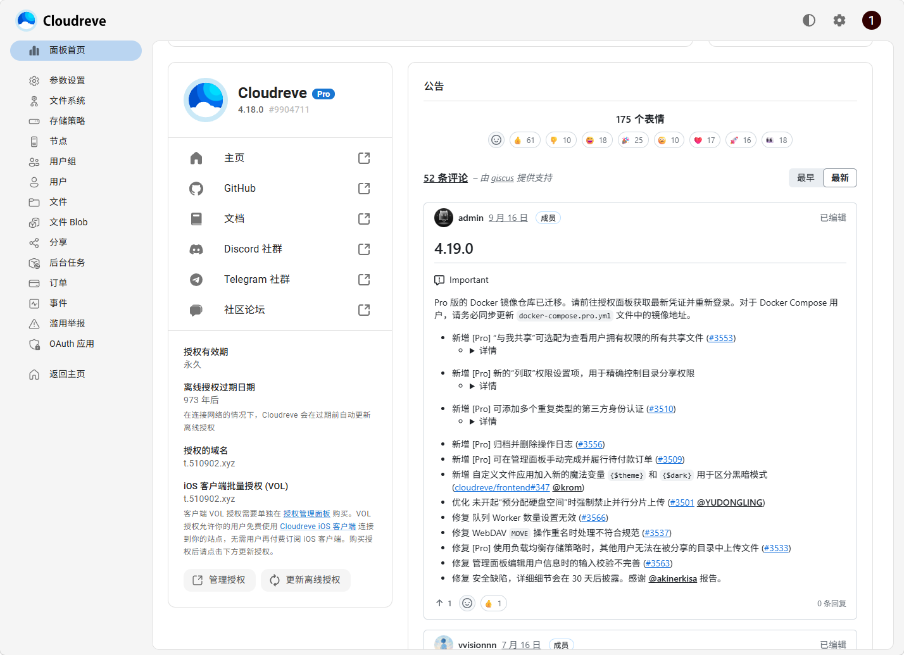
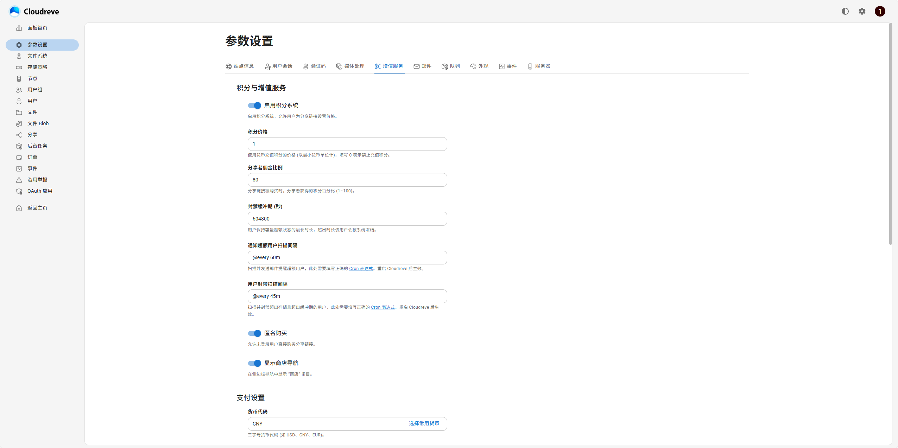
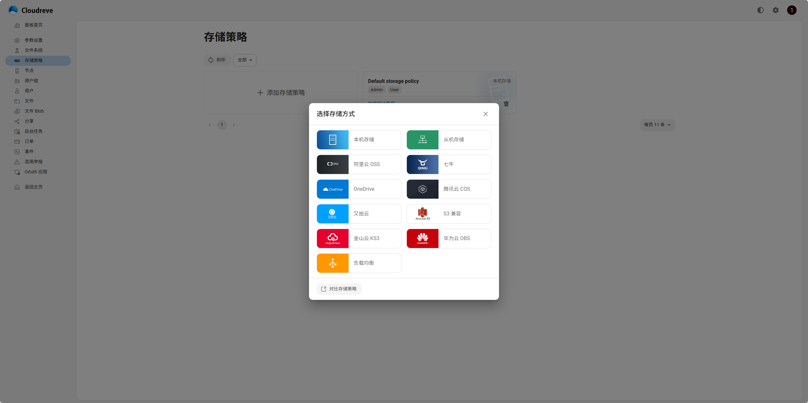

相比正版，这个版本主要做了三件事：

1. **内置完整授权**：有效期至 2999 年，离线可用，不联网、不回调、不校验域名。
2. **保留 Pro 全部功能**：后台所有模块可用，包括用户组、存储策略、分享管理、审计日志、归档任务等。
3. **真正开箱即用**：纯 shell 启动脚本，不依赖 Python / Node / 数据库服务。

提供 **Linux amd64** 版和 **Docker** 版，按需选择。

## 下载链接

1. [Cloudreve（网盘一）](https://pan.510904.xyz/s/jXsY)
2. [Cloudreve_4.18_Pro（网盘二）](https://cper1145.lanzouw.com/b00hs7ar7i)　密码：`64aj`

> **仅用于技术学习与交流，请勿用于非法用途。**
